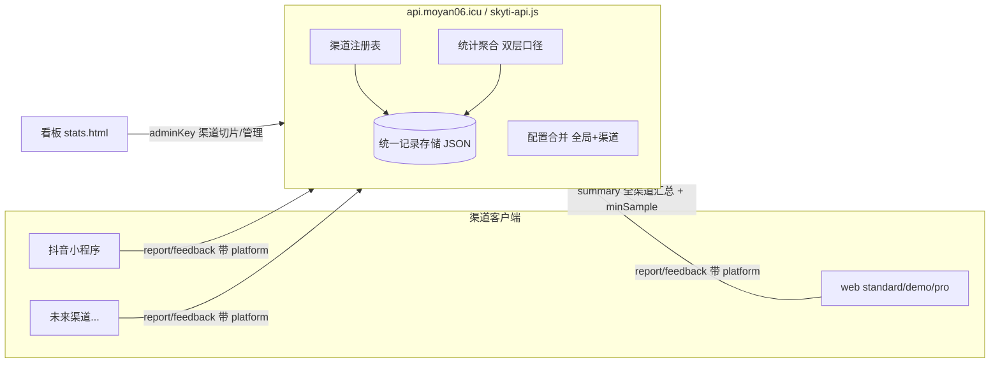

# 设计：api.moyan06.icu 多渠道架构

对应 `requirements.md`。文末含 **5 个待拍板决策**。

## 总体架构



## 模块边界

1. **渠道注册表（registry）**：渠道元数据唯一事实源，取代硬编码白名单。
2. **记录存储（store）**：单 JSON 文件 records 数组 + logins 存储，结构不变，`platform` = 渠道 key。
3. **配置合并（config）**：全局配置 + 渠道配置 → `channel_config` 下发。
4. **统计聚合（aggregate）**：`aggregateAll()`（对外）/ `aggregateBy(ch)`（对内）。
5. **看板（dashboard）**：注册表驱动渲染 + 渠道管理面板。

## 数据模型

### 渠道注册表（新增，服务端数据目录 channels.json）

```json
{
  "schema": 2,
  "channels": {
    "web":       { "name": "网页端",     "enabled": true, "reportEnabled": true, "since": 0, "order": 1, "ext": {} },
    "douyin_mp": { "name": "抖音小程序", "enabled": true, "reportEnabled": true, "since": 0, "order": 2, "ext": {} }
  }
}
```

字段说明：`key` 即 wire 上的 platform 值；`name` 展示名；`enabled` 总开关（关 = 拒收 + 看板隐藏，历史可查）；`reportEnabled` 上报开关（可只读停写）；`since` 上线时间（统计切片起点）；`order` 看板排序；`ext` 渠道专属扩展槽（主题、分享文案等，不污染主结构）。

### 记录（不变）

```json
{ "platform": "douyin_mp", "code": "INFJ", "cn": "…", "levels": "M", "v": "standard",
  "ts": 0, "uid": "u…", "feedback": "…", "feedbacks": [], "fbId": "", "refTs": 0,
  "fbOnly": true, "detail": {} }
```

- `platform`：渠道 key，全链路必带（fbOnly 条目同样带）。10-30 丢字段事故后，此列为**受保护字段**（见测试策略）。
- 存储布局不变：records + logins 两份 JSON；注册表独立 channels.json，admin 改配置不动数据文件。

## 双层统计口径（核心规则）

- **对外 summary（C 端真实数据）**：`records.filter(!fbOnly)` 全渠道合计 → `total`/`counts`；`minSample` 全局判定达标切真实占比。客户端零渠道感知，接入即得全局真实数据。
- **对内 stats（管理）**：支持 `ch=` 切片；看板 Tab（全部 / 各渠道）；删除渠道护栏保留。
- 规则固化三处一致：skyti-api.js summary 注释 + 本文档 + 接入契约文档。

## API 设计（增量兼容）

| 接口 | 方法 | 权限 | 现状 | 变化 |
|---|---|---|---|---|
| action=summary | GET | 公开 | 全渠道 total/counts/minSample | 保持语义；新增可选 `ch` 切片 |
| action=stats | GET | adminKey | records，platform 过滤（硬编码白名单） | 白名单改读注册表；`platform` 保留并加别名 `ch` |
| action=my | GET | 公开(uid) | 本人历史 | 不变 |
| action=report | POST | 公开 | platform 归一（不认识→web） | 改注册表校验：未注册→拒绝 `unknown_channel`（决策 2）；缺省→web 兼容 |
| action=feedback | POST | 公开 | fbId 幂等、fbOnly 入库 | 同上校验 |
| action=login | POST | 公开 | 抖音 openid 绑定 | 不变（未来渠道账号绑定走 ext 扩展） |
| action=link | POST | 公开(uid) | uid 过户 | 不变 |
| action=delete | POST | adminKey | ts 删除 + 平台护栏 + 删前快照 | 不变（白名单改读注册表） |
| action=channels | GET | 公开 | — | **新增**：enabled 渠道列表（key/name/order） |
| action=channel_config | GET | 公开 | — | **新增**：`ch` 生效配置（全局+渠道合并，服务端优先） |
| action=channel | POST | adminKey | — | **新增**：注册表 upsert / 停启用 |

## 看板改造

- 渠道 Tab / 平台卡片 / 趋势拆线由注册表驱动（「全部」+ 每渠道），新渠道注册后自动出现。
- 渠道管理面板（adminKey 登录后可见）：启停、改名、reportEnabled、排序、ext 编辑。
- fbOnly 处理维持现状（只进反馈卡 / CSV 导出，不进统计）。
- `/web`、`/dy` 分支路由保留；CUR_PLATFORM 映射注册表 key（双保险过滤不变）。
- 改动入口 `standard/public/stats.html` → sync_all.py 分发 demo/pro（项目约定）。

## 新渠道接入契约（5 步）

1. admin API 注册渠道 key（或部署时写 channels.json）→ `enabled: true`。
2. 客户端 report/feedback 统一带 `platform: '<key>'`（web=fetch、抖音=tt.request 现成 adapter 照抄）。
3. 真实稀有度直接消费 `summary.minSample` 全局口径，无需渠道侧逻辑。
4. 可选：启动拉 `channel_config&ch=<key>` 做远程配置（失败回落本地 config——沿用 minSample 兜底模式）。
5. 看板自动出现渠道 Tab 与卡片；上线前跑一遍冒烟即可。

## 安全

- channel 增删改、stats、delete 均需 adminKey（沿用现状）；channels / channel_config 公开只读且不含敏感信息。
- platform 校验白名单化（注册表），杜绝任意字符串入库。
- 删除护栏与删前快照（trash.jsonl）保留。
- 密钥不出现在代码库与文档（env / 部署脚本注入）。

## 测试与回归保护

- `node --check` 语法门禁（现状惯例）。
- 冒烟脚本（新增 `scripts/smoke-channels`，本地/线上可跑）：
  1. report 带注册渠道 → stats&ch= 能查到且 platform 保真（10-30 事故回归点）；
  2. 未注册渠道上报 → 拒绝；
  3. 缺省 platform → 归 web；
  4. summary 全渠道 total = 各渠道之和（排除 fbOnly）；
  5. fbOnly 不进 summary；
  6. delete 渠道护栏。
- 看板标记检查：minSample 数值、fbOnly 处理、渠道 Tab 生成。
- 小程序 simulator-compile 编译验证（动到小程序侧时）。

## 存储迁移路径（不预先实现）

记录量超约 5 万或写入冲突时迁 SQLite（better-sqlite3）：records 即表 rows、platform 建索引；API 层不变。注册表 / 配置天然独立文件，不受影响。

## 待拍板决策

1. 渠道 wire 字段沿用 `platform` 不改名 → **建议沿用**（零客户端破坏）。
2. 未注册渠道上报：严格拒绝（改现状「归 web」）→ **建议严格拒绝**（防脏数据；已上线客户端不受影响）。
3. minSample 维持全局 300、不做分渠道阈值 → **建议维持**（即「全渠道汇总达标切真实数据」）。
4. 注册表存服务端数据目录 + admin API 管理 → **建议是**。
5. 首个新渠道试点选型（微信小程序 / 独立 H5 / QQ 小程序 / 其他）→ **待你定**。
